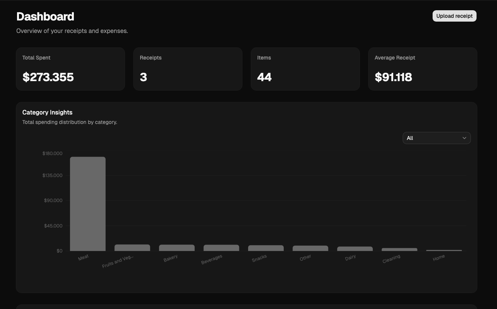
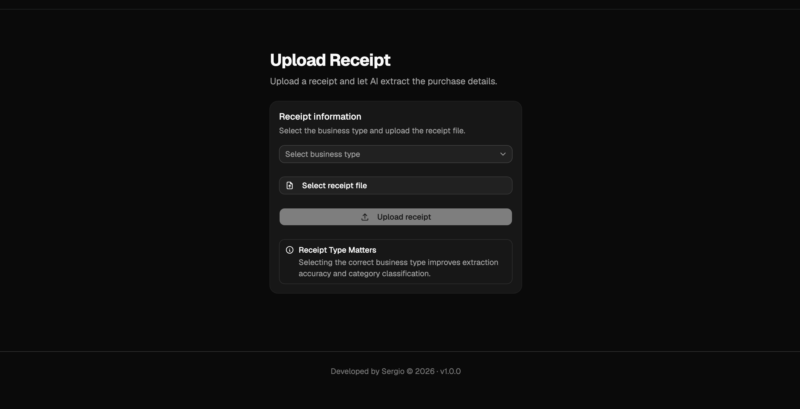
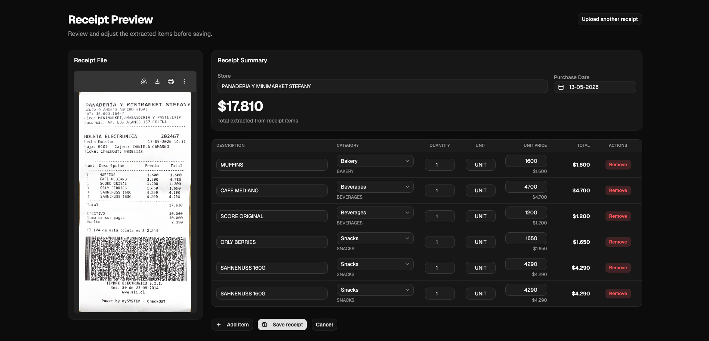
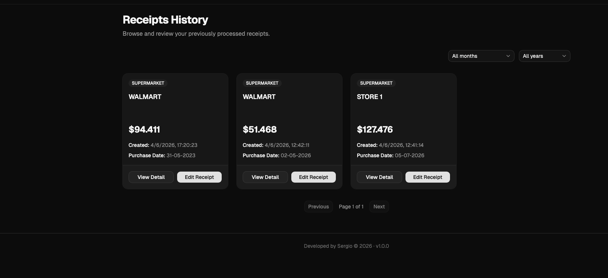
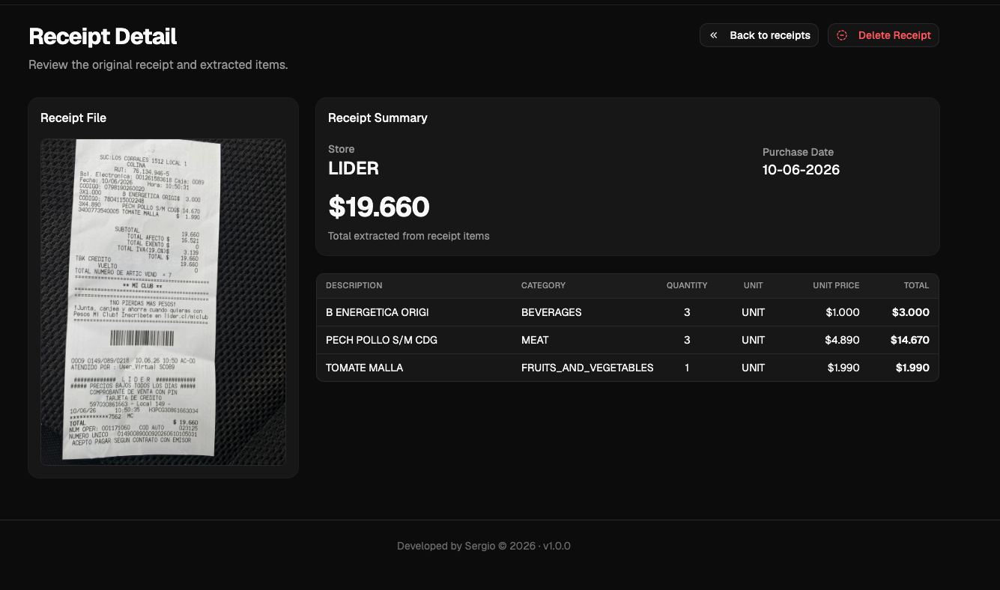
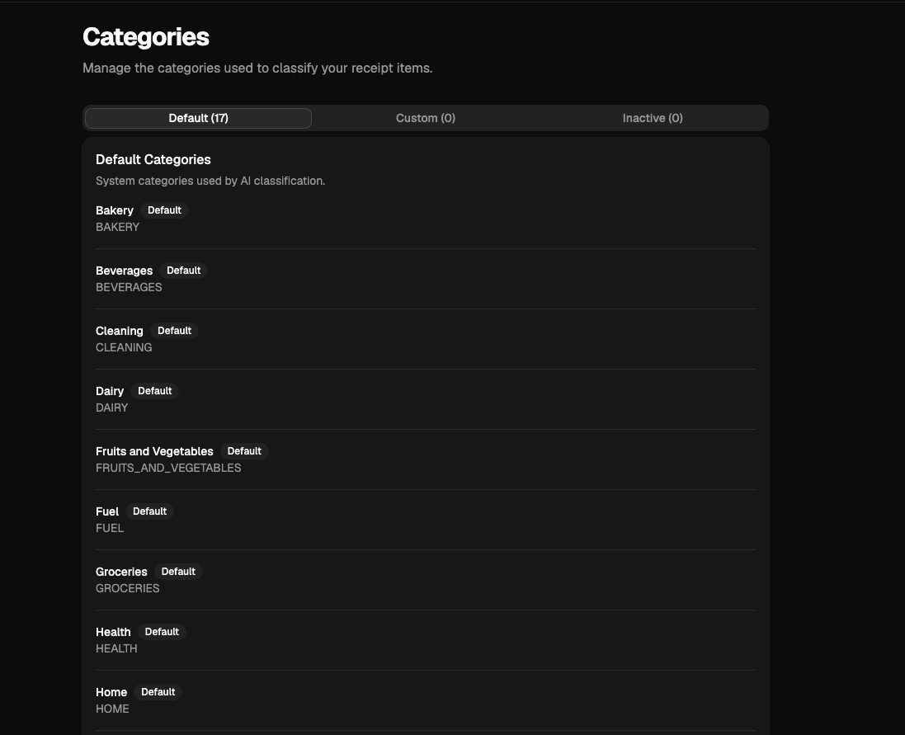
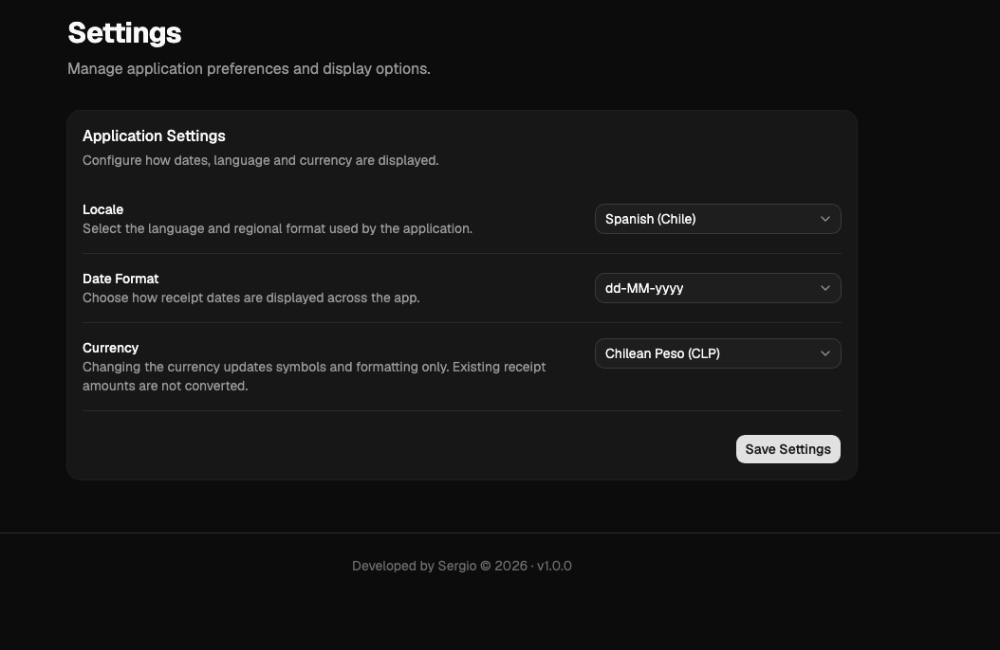

# Guarda tu Boleta

**Guarda tu Boleta** is an AI-powered web application for capturing, organizing, reviewing, and analyzing household receipts. It is built with Next.js, Prisma, Neon PostgreSQL, and OpenAI.

The product automates receipt processing by extracting purchase information from images and PDF receipts, allowing users to review, edit, and categorize purchases before saving them.

It also provides spending insights through dashboards and category-based analytics.

**Production:** [https://guardatuboleta.app](https://guardatuboleta.app)

The repository technical name remains `expenses-app`.

---

## Why I Built This

This project started as a personal tool to simplify household expense tracking while exploring AI-assisted document processing using OpenAI.

The goal was to build a complete end-to-end application covering:

* Authentication and user ownership
* File storage and management
* AI-powered receipt extraction
* Data validation and correction workflows
* Analytics and reporting
* Modern full-stack architecture using Next.js

---

## Screenshots

### Dashboard



### Upload Receipt



### Receipt Preview



### Receipt History



### Receipt Detail



### Categories



### Settings



---

## Features

### Authentication

* Authentication with [Clerk](https://clerk.com/)
* Route protection via Next.js proxy (`proxy.ts`)
* Onboarding flow that provisions the user in the database
* User ownership and data isolation

### Receipt Processing

* Upload receipt images (JPEG, PNG, WebP) and PDF files
* AI-powered extraction using the OpenAI Responses API (`gpt-4.1-mini`)
* Receipt types: supermarket, market, and gas
* Editable extraction preview before saving
* Automatic receipt item categorization using the user's active default categories
* Local and Vercel Blob storage support

### Receipt Management

* Receipt history with pagination
* Filters by month, year, and business type
* Receipt detail view
* Receipt editing
* Receipt deletion (including associated file cleanup)

### Categories

* Default categories seeded per user on first use
* Custom user categories
* Category activation and deactivation
* Manual category reassignment on receipts

### Dashboard

* Total spending summary
* Monthly expenses chart
* Spending by category (with optional month filter)
* User-specific analytics

### User Preferences

* Language selection (English and Spanish)
* Locale configuration
* Currency formatting (CLP, USD, EUR)
* Date formatting

### Profile

* View signed-in user information from Clerk

---

## Technology Stack

### Frontend

* Next.js 16 (App Router)
* React 19
* TypeScript
* Tailwind CSS 4
* shadcn/ui

### Backend

* Next.js Route Handlers and Server Actions
* Prisma ORM 7 with `@prisma/adapter-pg`
* PostgreSQL

### AI

* OpenAI Responses API
* GPT-4.1 Mini

### Authentication

* Clerk

### Storage

* Local file storage (`public/uploads/`, development)
* Vercel Blob Storage (production)

### Testing

* Vitest

---

## Architecture

Receipt processing flow:

```text
Upload File
    ↓
Storage (local or Vercel Blob)
    ↓
POST /api/receipts/extractions (HTTP 202)
    ↓
PostgreSQL processing job
    ↓
Receipt worker (pnpm worker)
    ↓
Review & confirm
    ↓
Dashboard & Analytics
```

Extraction runs outside the web request. The browser polls for status, and the header bell reads the durable notifications the worker writes when a job succeeds or fails permanently.

Application structure:

```text
app/
├── api/           Route handlers (receipts, settings, dashboard)
├── components/    Feature UI components
├── lib/           Domain logic (auth, receipts, storage, i18n, settings)
├── services/      Receipt processing orchestration
├── prompts/       OpenAI prompt templates by receipt type
├── schemas/       Zod validation schemas
└── [routes]/      App Router pages
```

Route protection is handled in `proxy.ts` using Clerk middleware. Most pages are Server Components that query Prisma directly; interactive flows (upload, charts, navigation) use Client Components.

---

## Running Locally

### Prerequisites

* Node.js 22+
* PostgreSQL database (for example, [Neon](https://neon.tech/))
* OpenAI API key
* Clerk application (publishable and secret keys)

### Installation

Clone the repository:

```bash
git clone <repository-url>
cd expenses-app
```

Install dependencies:

```bash
pnpm install
```

---

### Environment Variables

Create a `.env` file in the project root. See `.env.example` for the full list:

```env
DATABASE_URL=

OPENAI_API_KEY=

STORAGE_DRIVER=local
NEXT_PUBLIC_STORAGE_DRIVER=local

NEXT_PUBLIC_CLERK_PUBLISHABLE_KEY=
CLERK_SECRET_KEY=
NEXT_PUBLIC_CLERK_SIGN_IN_URL=/login
NEXT_PUBLIC_CLERK_SIGN_UP_URL=/sign-up
NEXT_PUBLIC_CLERK_AFTER_SIGN_IN_URL=/receipts
NEXT_PUBLIC_CLERK_AFTER_SIGN_UP_URL=/receipts
```

For Vercel Blob storage, also set:

```env
STORAGE_DRIVER=vercel-blob
NEXT_PUBLIC_STORAGE_DRIVER=vercel-blob
BLOB_READ_WRITE_TOKEN=
BLOB_STORE_ID=
BLOB_WEBHOOK_PUBLIC_KEY=
```

---

### Database Setup

Generate Prisma Client:

```bash
pnpm prisma generate
```

Apply existing migrations:

```bash
pnpm prisma migrate deploy
```

Optional:

```bash
pnpm prisma studio
```

---

### Creating New Migrations

After modifying:

```text
prisma/schema.prisma
```

Create and apply a migration:

```bash
pnpm prisma migrate dev --name describe_your_change
```

Regenerate Prisma Client:

```bash
pnpm prisma generate
```

Example:

```bash
pnpm prisma migrate dev --name add_receipt_status
pnpm prisma generate
```

---

### Development Reset

Only for local development:

```bash
pnpm prisma migrate reset
```

If working with a disposable database:

```bash
pnpm prisma db push
```

Do not use these commands in production environments.

---

### Start Development Server

```bash
pnpm dev
```

`pnpm dev` runs the test suite first (`predev` hook), then starts two independent processes: the Next.js dev server and the receipt worker (`pnpm worker --daemon`). Stopping that command stops both processes. If either process exits, the other is stopped as well. `pnpm dev:web` starts only Next.js. `pnpm build` and `pnpm start` do not start the worker, and a Next.js host such as Netlify or Vercel does not start it either.

Open:

```text
http://localhost:3000
```

---

### Scripts

```bash
pnpm dev              # Run tests, then start Next.js and the receipt worker
pnpm dev:web          # Start Next.js without the receipt worker
pnpm build            # Generate Prisma client and build
pnpm start            # Start production server
pnpm lint             # ESLint
pnpm test             # Vitest (single run)
pnpm test:watch       # Vitest watch mode
pnpm test:coverage    # Vitest with coverage
pnpm format           # Prettier
pnpm worker --once    # Drain currently eligible receipt jobs, then exit
pnpm worker --daemon  # Poll for receipt jobs until stopped
```

---

## Receipt worker

The Next.js app enqueues one `ProcessingJob` per uploaded receipt. A separate Node process claims those jobs from PostgreSQL. It does not use Redis, a third-party queue, or a hosting provider's background-function API. Run it beside the web app with the same `DATABASE_URL` and the same storage configuration the upload used.

### Commands

`pnpm worker --once` claims every job that is eligible when the process starts, handles those jobs, and exits. A retry whose `availableAt` is still in the future is left for the next run. The process exits 0 when it can reach the database, including when an extraction fails and that failure is recorded. It exits non-zero only when the worker itself cannot run (for example, a missing `DATABASE_URL` or both mode flags).

`pnpm worker --daemon` uses the same claim and processing code, then waits and polls again. Stop it with SIGINT or SIGTERM. The in-flight job finishes; the loop does not start another one after the signal.

Pass exactly one of `--once` or `--daemon`.

### Environment

Required for every worker process:

* `DATABASE_URL` — PostgreSQL database that already has the receipt and processing-job migrations.
* `OPENAI_API_KEY` — used when a job calls the extraction model.
* `STORAGE_DRIVER` — `local`, `blob`, or `vercel-blob`. `blob` and `vercel-blob` both use the existing Vercel Blob store. `local` reads `public/uploads` on the machine running the worker.

Local storage also reads files from `public/uploads` on the machine running the worker. Blob storage also needs `BLOB_READ_WRITE_TOKEN`. The worker downloads the stored file itself, so a `local` driver only works when the worker can see those files.

Optional, with defaults:

| Variable | Default | Purpose |
| --- | --- | --- |
| `WORKER_POLL_INTERVAL_MS` | `5000` | Daemon idle wait. `--once` does not poll. |
| `RECEIPT_WORKER_CONCURRENCY` | `1` | Jobs processed at the same time. |
| `RECEIPT_WORKER_LEASE_MS` | `240000` | How long a claimed job stays locked. |
| `RECEIPT_WORKER_HEARTBEAT_MS` | `30000` | How often the lock is extended while a job runs. |
| `RECEIPT_WORKER_ATTEMPT_TIMEOUT_MS` | `180000` | Limit for one extraction attempt. |

`WORKER_POLL_INTERVAL_MS` must be a positive integer. A missing or blank value uses 5000. `0`, a negative number, or any other invalid value stops the worker with an error before it polls. The same positive-integer check applies to the other worker variables in this table.

### Local, QA, and production

`pnpm dev` starts the worker in the same checkout as Next.js. `pnpm dev:web`, `pnpm worker --once`, and `pnpm worker --daemon` remain available on their own. Local development can use `STORAGE_DRIVER=local`. QA and production each need their own `DATABASE_URL`. Do not point a worker at another environment's database. The worker is not part of the Next.js server, so production hosting does not run it unless you start `pnpm worker` as a separate process.

QA and production uploads live in Vercel Blob. The scheduled workers set `STORAGE_DRIVER` to `blob`, which uses that same store, and download each receipt from its stored URL. They do not read `public/uploads`. The worker still needs `BLOB_READ_WRITE_TOKEN` when it deletes a stored file. It does not need to run on the same host as the Next.js server.

### Scheduled QA and production runs

Two GitHub Actions workflows run `pnpm worker --once` once per day. They do not build, deploy, or migrate the web application. They are not triggered by pushes or pull requests, so they stay out of the deployment pipelines. GitHub starts scheduled workflows from the repository default branch, which is `staging`.

| Workflow | GitHub Environment | UTC | Continental Chile, UTC−3 | Continental Chile, UTC−4 |
| --- | --- | --- | --- | --- |
| Receipt worker QA | `QA` | 11:00 | 08:00 | 07:00 |
| Receipt worker PROD | `PROD` | 11:30 | 08:30 | 07:30 |

Continental Chile (`America/Santiago`) uses UTC−3 from 24:00 on the first Saturday of September until 24:00 on the first Saturday of April, and UTC−4 for the rest of the year. The Magallanes and Chilean Antarctic region stays on UTC−3 all year, so those clocks match the UTC−3 column. The cron expressions stay on UTC. When continental Chile changes clocks, the local hour of these runs moves by one hour. GitHub may also start a scheduled run later than the cron minute when Actions is busy.

Create the environments before the first run:

1. Open the repository on GitHub, then Settings → Environments.
2. Create an environment named `QA` and another named `PROD`. Use those exact names.
3. On `PROD`, limit deployment branches to `staging`. Leave required reviewers off. A required reviewer would pause the daily run until someone approves it.
4. On `QA`, allow the branches that should be allowed to run the QA worker. The daily run uses `staging`.
5. In each environment, add these secrets. Do not also create them as repository secrets. A repository secret with the same name is visible to every workflow when the environment secret is missing, which could point QA at the production database.
   * `DATABASE_URL` — that environment's PostgreSQL database. QA and PROD must be different databases.
   * `OPENAI_API_KEY` — key used for extraction.
   * `BLOB_READ_WRITE_TOKEN` — token for the blob store that holds that environment's receipt files.
6. In each environment, add the variable `STORAGE_DRIVER` with the value `blob`.
7. Merge both workflow files to `staging`. GitHub only schedules workflow files that are on the default branch. Until then, use Run workflow from the branch that contains them. The production workflow still refuses every branch other than `staging`.

Run either workflow manually from Actions → the workflow name → Run workflow. For production, select `staging`. Any other branch fails before the production environment or its secrets are used. QA can be started from another branch when that branch should be exercised against the QA database only.

Open a run to read its logs. The configuration step names any missing variable and stops there. It does not print secret values. The worker step prints JSON events such as `worker.start`, `job.succeeded`, `job.retry`, `job.failed`, and `worker.exit`. A non-zero worker exit fails the run. The job limit is 30 minutes.

`pnpm worker --once` handles jobs that are already eligible, then exits. A retry whose `availableAt` is still in the future waits for the next day's run. With one run per day, that next run is the real retry delay. The 30-second and 2-minute waits are only a lower bound. A run that stops during an attempt leaves the job leased. Another run can claim it after the 4-minute lease expires. The QA and production concurrency groups each allow one run at a time. A second run for the same environment waits instead of starting a second worker. Claims also use `FOR UPDATE SKIP LOCKED`.

### Retries, leases, and concurrency

Each receipt has one job. Retries update that job; they do not create another one. Transient failures (including invalid model output, rate limits, and network errors) wait 30 seconds after the first attempt and 2 minutes after the second. The third failure is permanent: the receipt becomes `EXTRACTION_FAILED` and one failure notification is stored. Some errors, such as a missing file or an authentication failure, are permanent on the first attempt.

The default concurrency is 1. A claimed job holds a 4-minute lease, refreshed every 30 seconds. If the process stops during an attempt, another run can reclaim the job after the lease expires, until the attempt budget is spent. With `--once` scheduled infrequently, the next scheduled run is the real retry delay; the 30-second and 2-minute waits are only a lower bound.

Successful and permanently failed jobs write a `Notification` row. The header bell reads those rows. Confirming a receipt remains a separate user action. Unconfirmed receipts stay out of spending totals.

---

## Project Status

Current version:

```text
v2.0.1
```

This release includes:

* Clerk authentication
* Multi-user support with per-user data isolation
* AI receipt extraction and review workflow
* Receipt editing and deletion
* Categories management
* Dashboard analytics
* User settings (language, locale, currency, date format)
* Local and Vercel Blob storage support
* English and Spanish UI
* Responsive UI

---

## Roadmap

Planned future improvements:

* Budget management
* Budget alerts
* Spending projections
* Household consumption analytics
* Product inflation tracking
* Purchase recommendations
* Advanced dashboard insights

---

## License

MIT
